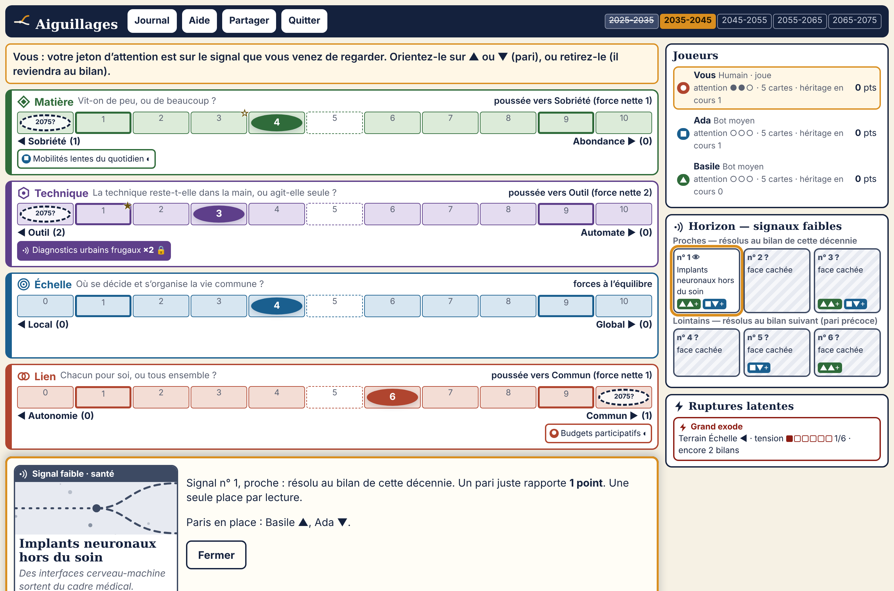

# Aiguillages

**Un jeu sur les futurs possibles, 2025 → 2075.** 2 à 5 joueurs, 14 ans et plus, 45 à 75 minutes à la table, 20 à 40 minutes en ligne contre des bots.

Cinq décennies, **un seul monde**, et autant de futurs souhaitables que de joueurs. Installez des **tendances** qui pèseront jusqu'en 2075, repérez les **signaux faibles** avant les autres,
préparez-vous aux **ruptures** — et visez juste : un aiguillage franchi ne se refranchit pas, et le monde ne s'arrête pas là où vous le vouliez.

Le jeu est conçu et équilibré **par simulation** (des dizaines de milliers de parties jouées par des bots aux stratégies variées) et développé **en ouvert** : chaque version des règles,
chaque hypothèse et chaque mesure est dans ce dépôt.



## Jouer

- **En ligne** : <https://gspch.github.io/futurs-2075/> — solo contre 1 à 4 bots (trois niveaux), ou à plusieurs sur le même écran. Un tutoriel guidé de cinq minutes fait découvrir les trois types de cartes en les jouant.
  *(Le déploiement GitHub Pages se déclenche sur la branche `main` : voir « État du dépôt » ci-dessous.)*
- **En local** : `npm ci && npm run dev`, puis ouvrez l'adresse affichée.
- **Sur table** : imprimez [`docs/CARTES.pdf`](docs/CARTES.pdf) (116 cartes 63 × 88 mm, 9 par page, traits de coupe, dos, jetons) et [`docs/PLATEAU.pdf`](docs/PLATEAU.pdf),
  lisez [`docs/REGLES.pdf`](docs/REGLES.pdf) (4 pages) et gardez [`docs/AIDE_DE_JEU.pdf`](docs/AIDE_DE_JEU.pdf) sous la main.

### Le principe en une minute

Le monde est décrit par quatre axes, chacun tendu entre deux pôles dont aucun n'est « le bon » : **Matière** (Sobriété ↔ Abondance), **Technique** (Outil ↔ Automate),
**Échelle** (Local ↔ Global), **Lien** (Autonomie ↔ Commun). À votre tour, une action :

| Action | Effet |
|---|---|
| **Installer** une tendance | Elle poussera son axe à *chaque* bilan de décennie, s'ancrera, puis se verrouillera. |
| **Veiller** un signal faible | Vous y posez un jeton d'attention et le regardez en secret. Il a deux lectures ; celle qui se réalisera dépend du contexte. Pariez, ou retirez votre jeton. |
| **Se préparer** à une rupture | Elle est visible de loin et improbable… sauf si le monde s'avance loin vers son terrain. |
| **Infléchir** une tendance | Possible tant qu'elle est jeune ; de plus en plus cher ; puis impossible. |
| **Prospecter** | Piocher des tendances. |

En 2075, on compte la **vision** (votre futur souhaitable : des cases précises à atteindre, sans les dépasser), l'**héritage** (vos tendances qui se trouvent du côté où le monde a fini) et l'**anticipation** (signaux et ruptures bien vus).

## Relancer la simulation

```bash
npm ci
npm test                 # 38 tests (règles, bots, partage), dont 100 parties aléatoires sans état illégal
npm run sim:final        # 10 000 parties par configuration (2, 3, 4, 5 joueurs) + duels d'expert : les 8 critères, avec intervalles de confiance
npm run adverse          # test adverse : recherche évolutionnaire d'une stratégie dominante (plus de 200 variantes)
npm run graphiques       # régénère les graphiques du rapport depuis simulations/
npm run pdf              # régénère les PDF depuis contenu/ et docs/*.md (nécessite Playwright : npx playwright install chromium)
```

`npm run sim:final` équivaut à `npm run sim -- rapport --parties 10000 --graine 2075` (une demi-heure environ sur 4 cœurs) et écrit `simulations/resume-v<version>.json`.
Pour une mesure rapide : `npm run sim -- explorer --parties 2000 --duels 300`. Tout est déterministe : même graine, mêmes parties.

Résultats, méthode et limites : [`docs/RAPPORT_EQUILIBRAGE.md`](docs/RAPPORT_EQUILIBRAGE.md).

## Le dépôt

| Dossier | Contenu |
|---|---|
| `contenu/` | Les cartes et les paramètres d'équilibrage, en JSON validé par schéma. Seule source du jeu web, du simulateur et des PDF. |
| `moteur/` | Le moteur de règles : TypeScript strict, pur, déterministe, état sérialisable. `coupsLegaux()` puis `jouer()` : il n'y a pas d'autre porte. |
| `bots/` | Neuf stratégies paramétrables (aléatoire, glouton, quatre spécialistes, chasseur de signaux, parieur de ruptures, bloqueur) et un expert par recherche Monte-Carlo sur mondes déterminisés. |
| `simulateur/` | Parties en masse sur tous les cœurs, calcul des critères, test adverse, garde-fou d'intégration continue. |
| `web/` | Le jeu dans le navigateur (Vite, sans framework, sans serveur). Les bots tournent dans un Web Worker. |
| `recit/` | Mise en mots des coups et des trajectoires ; identité visuelle (SVG générés) partagée par le web et les PDF. |
| `outils/` | Générateurs de PDF et de graphiques, protocole d'itération. |
| `docs/` | Règles, aide de jeu, cartes, rapport d'équilibrage, notes de conception, partie commentée, autocritique, décisions, itérations. |

À lire dans l'ordre si vous voulez comprendre comment le jeu a été fait : [`NOTES_DE_CONCEPTION`](docs/NOTES_DE_CONCEPTION.md) → [`ITERATIONS`](docs/ITERATIONS.md) → [`RAPPORT_EQUILIBRAGE`](docs/RAPPORT_EQUILIBRAGE.md) → [`AUTOCRITIQUE`](docs/AUTOCRITIQUE.md).
Une partie racontée tour par tour, avec son lien de rejeu : [`PARTIE_COMMENTEE`](docs/PARTIE_COMMENTEE.md).

## Contribuer

Proposer une carte, une règle, signaler un déséquilibre (avec données à l'appui) : voir [`CONTRIBUTING.md`](CONTRIBUTING.md) et le [code de conduite](CODE_OF_CONDUCT.md).
Les faiblesses connues et les pistes non traitées sont dans les [issues](https://github.com/gspch/futurs-2075/issues), étiquetées `règles`, `équilibrage`, `interface`, `contenu`.

## État du dépôt

- La branche de développement `claude/sweet-dijkstra-alv48d` est la branche par défaut. L'environnement GitHub Pages du dépôt n'accepte que `main` :
  **renommer la branche en `main`** (Settings → Branches) puis relancer le workflow « Déploiement GitHub Pages » met le jeu en ligne à l'adresse ci-dessus. Rien d'autre n'est à modifier.
- Les versions de règles v0.1 à v1.0 sont décrites dans [`docs/ITERATIONS.md`](docs/ITERATIONS.md) avec le commit correspondant ; voir [`docs/DECISIONS.md`](docs/DECISIONS.md) pour ce qui n'a pas pu être poussé (tags, release).

## Licences

Code sous licence [MIT](LICENSE). Contenu du jeu — règles, textes et visuels des cartes — sous [CC BY-SA 4.0](LICENSE-CONTENU).
